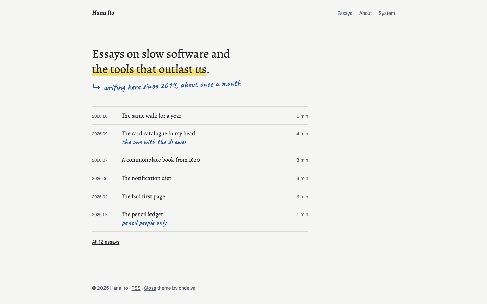

# Gloss

An Astro theme for a personal blog of long essays: a book page, a wide margin, and your footnotes written in it by hand. Free and MIT-licensed.

[Live demo](https://gloss-free.ondelva.com) · [Pro demo](https://gloss.ondelva.com)



## What it is

Gloss is for people who write essays and want them to read like a page someone has been reading with a pencil. The text is set in a book face at a comfortable measure. To its right is a margin, and that is where the theme keeps its character: your footnotes appear there in handwriting, beside the paragraph they belong to. A highlighter stroke and a pencil underline are two keystrokes away in Markdown. One pencil colour, one highlighter, no cards, no shadows.

**The gloss** is what it is built around. Write footnotes the way Markdown always has, `[^1]`, and Gloss moves each one into the margin next to the paragraph that mentions it. On a phone the note sits under its paragraph with a pencil rule. Long notes switch to small print, because nobody wants to read a paragraph of handwriting. Turn it off with one setting and you have ordinary footnotes again.

## Features

- Astro 7 + Tailwind CSS v4, static output; the only client-side JavaScript is the theme toggle and the margin-note spacing
- Footnotes as handwritten margin notes, numbered in reading order, under the paragraph on small screens
- `==highlight==` and `++pencil underline++` in Markdown, and in the home page's opening line
- A home page with an opening line and a handwritten note, an archive by year, an About page with margin notes too
- Word counts and reading times, RSS, sitemap, structured data
- Dark mode, responsive from 360px, Lighthouse 95+ on all four categories, checked in CI
- Type-safe content collection (Markdown and MDX), and `AGENTS.md` for Claude Code / Cursor

## Quick start

You need Node.js 22.12+ and pnpm 9 or newer (`npm i -g pnpm`). `package.json` pins the exact pnpm version, and pnpm 10+ switches to it on its own.

```sh
pnpm create astro@latest my-site -- --template ondelva/astro-theme-gloss
cd my-site
pnpm install
pnpm dev
```

`pnpm dev` also serves `/styleguide`: every colour token, the type sizes, and a sample essay with its margin notes. It is not part of a build.

## Configure

Everything site-specific lives in `src/config.ts`: your name, the URL, the home page's opening line, the switches. Colours are tokens you override in `src/styles/theme.css`.

- [docs/content.md](docs/content.md): writing a post, margin notes, the hand marks
- [docs/customization.md](docs/customization.md): every config group, the tokens, fonts, the footer credit
- [docs/deploy.md](docs/deploy.md): build, hosting, CI

## Deploy

Static output. Works on Cloudflare, Vercel, Netlify and GitHub Pages. One click and the host clones this repository into your account, builds it and puts it online:

[](https://deploy.workers.cloudflare.com/?url=https://github.com/ondelva/astro-theme-gloss)
[](https://app.netlify.com/start/deploy?repository=https://github.com/ondelva/astro-theme-gloss)
[](https://vercel.com/new/clone?repository-url=https://github.com/ondelva/astro-theme-gloss)

Set `SITE_URL` to your address afterwards. See [docs/deploy.md](docs/deploy.md).

## Free vs Pro

The free edition is a finished essay blog with margin notes. Pro adds ways to find, mark up and keep up with what you write.

|                | Free                             | Pro                                                       |
| -------------- | -------------------------------- | --------------------------------------------------------- |
| Pages          | Home, post, archive, about, 404  | + topics, reading log, search                             |
| Margin notes   | ✓                                | ✓ + contents in the margin                                |
| Hand marks     | `==highlight==`, `++underline++` | + `<Circle>`, `<Struck>`, `<Margin>`, a start-here circle |
| Series         | –                                | ✓                                                         |
| Search         | –                                | Pagefind, margin notes included                           |
| Subscribe      | –                                | Buttondown form, Giscus comments                          |
| Share cards    | One default image                | One per post, with its handwritten note                   |
| Colour presets | 1                                | 4                                                         |
| Font pairings  | 1                                | 2                                                         |
| License        | MIT                              | Commercial, unlimited end products                        |
| Footer credit  | One line, easy to remove         | None                                                      |
| Support        | GitHub Issues                    | Email (im@ondelva.com), 2 business days                   |

See the [Pro demo](https://gloss.ondelva.com).

## License

MIT, see [LICENSE](LICENSE).
Third-party assets: [THIRD-PARTY-NOTICES.md](THIRD-PARTY-NOTICES.md)
