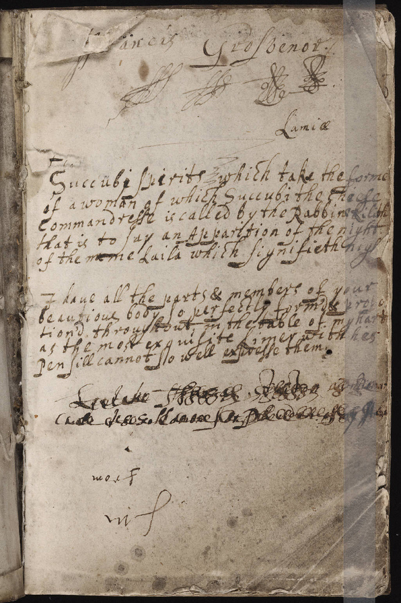

Last month, at work, I was checking image metadata for a batch of scans and ended up somewhere I had not planned to be. A colleague had left a link open. It went to a digitised commonplace book at the Beinecke Rare Book and Manuscript Library at Yale, kept around 1620 by a man named Francis Grosvenor. I was meant to be looking at file sizes. I looked at his first page for twenty minutes.

_Page one of a commonplace book kept around 1620, now at the Beinecke Library, Yale. Public domain._

The book is small, about 15 by 9.5 centimetres, so a little larger than the phone I was holding it on. It is also mostly blank. Only a handful of pages have been written on, and the rest wait with the patience of paper that never got its turn.[^1]

## What is on the page

Across the top, his name. Not once, but several times, in a row, the way you sign the back of a new pen to see whether it works. I know the habit. I do it on the first page of every notebook, and I have never told anyone, because it seems like the sort of thing a person should have grown out of by now. Apparently it has been going on for at least four hundred years.

Below that, the book does what the form was made to do. It holds passages copied from elsewhere, which is the whole idea of a commonplace book: you read something, you like it, you put it somewhere you can find it. I will not describe the passages, because I do not want to put words in a stranger's hand. What I can say is how they look. ==The writing speeds up where he seems to be in a hurry==, the letters leaning forward as if someone had called him to supper.

And there are the crossings out. Two lines near the bottom are struck through so heavily that the ink has nearly become a bar. He did not tidy that. He did not start a clean page. He crossed out the mistake, left it where it was, and moved on.[^2]

## Why I keep going back

I think what I like is that nobody was meant to see it. A printed book of 1620 was edited and corrected by several people before it reached a reader. This one reached no one, for centuries, and then a library photographed it and put it in front of me, on a Tuesday, between two spreadsheets.

My own notebooks have the same flaws. The name on the first page. The hurried copying. The crossing out that I leave in because rewriting it would feel like lying. For years I assumed these were signs I was doing it wrong. Francis Grosvenor suggests they are simply what the thing looks like when a person uses it.[^3]

I did finish the metadata that afternoon. The scans were all fine. I have not been able to say the same for the rest of my attention that week.

[^1]: The library's catalogue record says more than I have. I am only describing what I could see on screen, which is the first page and a few more.

[^2]: In my own archive work, the rule is never to delete the mistake in a record without noting that it was there. I did not expect to find the same rule written in ink.

[^3]: He also did not seem worried about running out of room. After a couple of pages, the book simply stops, and I find that more reassuring than any productivity advice I have read.
