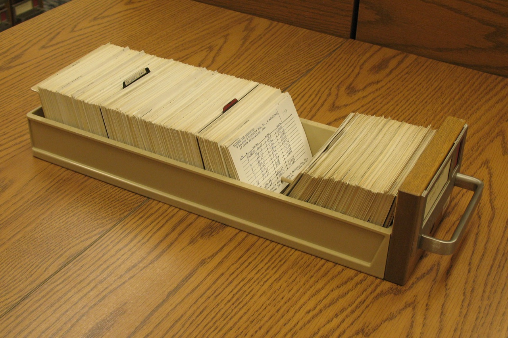

I work on software for a small archive, and most of my day is spent making things findable. So it is a little embarrassing that the best filing system I know is one I have never actually used. It is the card catalogue, and I only know it from photographs and from the way it keeps leaking into how I keep notes.

A few years ago I saw a photo of the Library of Congress copyright card catalogue. It holds copyright records from before 1978, indexed on 3 by 5 inch cards in long file drawers.[^1] In the photo, one typed card has been pulled up a little from the rest, like a tooth. I looked at that picture for much longer than a drawer of cards deserves.

_A drawer from the Library of Congress copyright card catalogue. Photo: Michael Holley, public domain._

## Three rules I stole

The first is one fact per card. A card cannot hold an argument, so you are forced to decide what the single claim is. When I started writing notes this way I discovered that about half of what I wrote down was not a fact at all. It was a mood. Moods are fine, but they belong in a notebook, not in the drawer.

The second is that the size is fixed. A 3 by 5 card holds roughly fifty words in my handwriting, and if I cannot say it in fifty words, I probably do not know it yet. I used to think the limit was a restriction. It turned out to be the only editor I could afford. ++The card does the cutting++ so I do not have to.[^2]

The third is the cross reference. On a real catalogue, a card for one heading says "see also" and sends you to another. Somebody had to write that by hand, which means somebody had to decide the two things were related, and that decision is most of the value. Software makes links cheap, and cheap links are the problem. I can link every note to every other note in an afternoon and learn nothing from the result. When I have to write "see also, card 41" in pencil, I only do it when I mean it.

## What I do now

My own version is unglamorous. I buy index cards in packs of a hundred and keep them in a shoebox that once held a pair of boots. I write one thing per card, in pencil, with a date in the corner and a topic at the top. When a card relates to another, I write the other card's topic at the bottom, and I do the same on the other card.

It takes about forty seconds a card. I have 212 of them. I counted last week, and the shoebox is about two thirds full, which is the first time I have ever known how full my own memory was.

The system has failures, and I should name them. Cards get misfiled. Topics drift, so a card filed under "sorting" really belongs under "order." I have a stack I call the maybe pile, and it is taller than the filed cards, which tells you something about my confidence.

But the failures are legible. When I misfile a card, I can see where it went wrong, because the whole system is something I can lay out on a table and look at. At work I have spent years with search indexes that return the wrong thing for reasons nobody in the building can explain, and I have come to value a failure that I can see.[^3]

If you want to try it, start with ten cards. Pick one subject you know well, and write one fact on each. You will find out quickly which ones were not facts.

[^1]: The records were kept on cards until the end of 1977, and the cards stayed in their drawers afterwards. I have never seen the drawers in person. I mention that so you do not picture me as someone who gets out more than I do.

[^2]: This is also why I stopped using the larger cards, the 4 by 6 ones. They are not much bigger, but I found that the extra inch of width and the extra inch of height arrived at about the same moment as my tendency to write a paragraph. A paragraph is where the vague part of the thought goes to hide, and I would rather it had nowhere to go, so I went back to the small cards and the vague part now has to show itself in the first two lines or get cut.

[^3]: A colleague says this is just nostalgia for a thing that was slower. She may be right. But slower and legible are not the same property, and I wanted the second one.
